# Deziro UI

从 DezirClip 提取的 React WebView 和 MyGo Native 组件。两套库提供独立的导出，可在同一个仓库里查看源码、主题和渲染对照。

| 导出 | 用途 | 许可证 |
| --- | --- | --- |
| [`@deziro/ui-react`](packages/ui-react) | React 组件、CSS 和 Web 主题 | [GPL‑3.0](packages/ui-react/LICENSE) |
| [`packages/ui-native/uikit`](packages/ui-native/uikit) | Go 原生组件，带标准浅色与深色样式 | [MIT](packages/ui-native/LICENSE) |
| [`packages/ui-native/theme`](packages/ui-native/theme) | Go 主题类型、调色板和样式接口 | [MIT](packages/ui-native/LICENSE) |
| [`packages/ui-presets`](packages/ui-presets) | 由 Web 样式生成的六套原生主题预设 | [GPL‑3.0](packages/ui-presets/LICENSE) |

## 使用

### React WebView

```sh
pnpm add https://github.com/qiyuanhuakai/deziro-ui/releases/download/v0.1.1/deziro-ui-react-0.1.1.tgz
```

```tsx
import ThemedSelect from "@deziro/ui-react/components/ThemedSelect";
import { loadBuiltinTheme } from "@deziro/ui-react/themes";
import "@deziro/ui-react/styles/base.css";
import "@deziro/ui-react/styles/components/index.css";

await loadBuiltinTheme("macos");
document.documentElement.classList.add("theme-macos", "light-mode");
document.body.classList.add("theme-macos", "light-mode");
```

组件接受应用传入的状态和回调。适合 React 19 和能处理 CSS 导入的 Web 构建环境。

### MyGo Native

```sh
go get github.com/qiyuanhuakai/deziro-ui/packages/ui-native/uikit@v0.1.1
```

```go
import "github.com/qiyuanhuakai/deziro-ui/packages/ui-native/uikit"

kit := uikit.Kit{Mode: "dark"}
kit.Apply(c)
```

使用自己的主题时，向 `uikit.NewKit` 传入语义颜色和控件样式。应用需要下方完整的 Web 对照主题时，可以额外导入 GPL 预设模块，并通过 `presets.Select("macos", "light").Kit()` 应用。

```sh
go get github.com/qiyuanhuakai/deziro-ui/packages/ui-presets@v0.1.1
```

## 主题

六套主题均提供浅色与深色模式。**macOS、Liquid Glass、Sci‑Fi** 由 qiyuanhuakai 原创。**Retro、Mica、Acrylic** 延续上游主题样式。由 Web CSS 采集的原生预设也包含共用控件样式，整个预设模块沿用 GPL。单独安装 MIT 原生组件时，可以使用其标准主题或提供自己的样式。

## 组件对照

每张图左侧是 React WebView，右侧是 MyGo Native。每套主题各有 22 张图。滚轮区域和缩放手柄展示交互后的状态。

完整验证覆盖六套主题、两种色彩模式和 49 个组件状态，共 588 个对照样本。

<details open>
<summary>macOS 深色</summary>

| 组件 | 两套库的实测画面 |
| --- | --- |
| 应用顶栏 |  |
| 虚拟历史列表 | 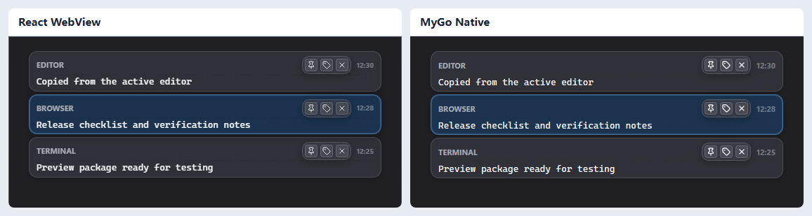 |
| 历史卡片 | 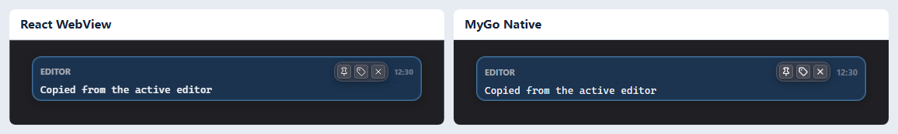 |
| 历史卡片信息栏 | 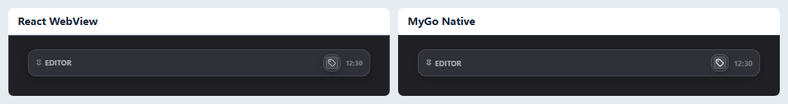 |
| 搜索栏 | 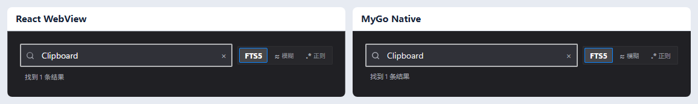 |
| 搜索历史 | 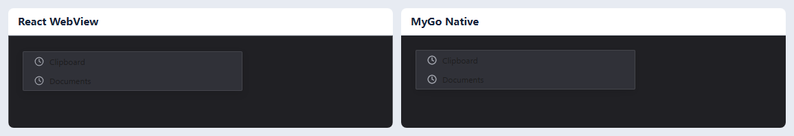 |
| 筛选项 |  |
| 匹配高亮 |  |
| 下拉选择 |  |
| 设置导航 |  |
| 设置页脚 |  |
| 设置折叠区 |  |
| 设置帮助 | 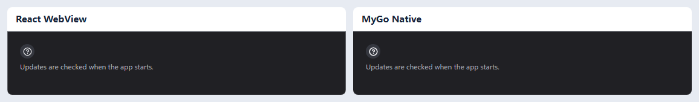 |
| 确认对话框 | 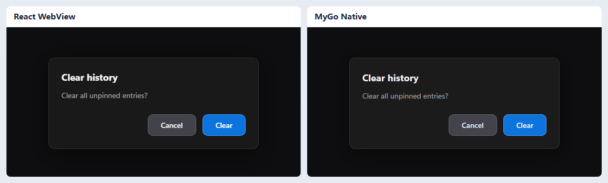 |
| 标签对话框 | 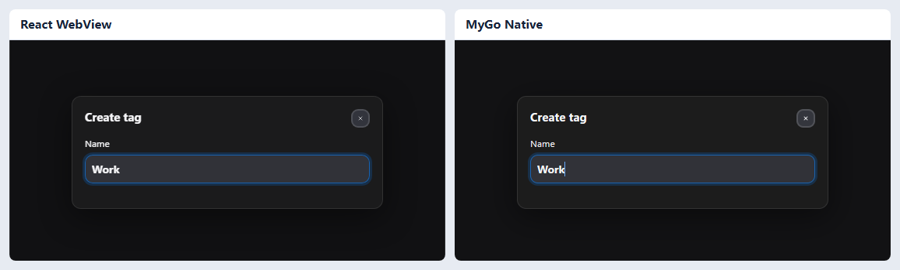 |
| 短提示 | 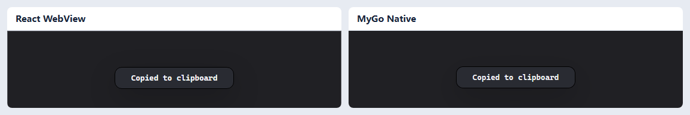 |
| 进度提示 |  |
| 附件预览 |  |
| 预览工具栏 |  |
| 图片预览 | 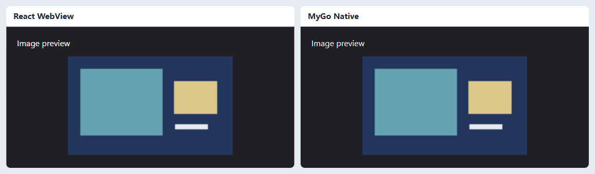 |
| 预览窗口缩放手柄 |  |
| 滚轮感应区域 |  |

</details>

<details>
<summary>Liquid Glass 深色</summary>

| 组件 | 两套库的实测画面 |
| --- | --- |
| 应用顶栏 |  |
| 虚拟历史列表 |  |
| 历史卡片 |  |
| 历史卡片信息栏 |  |
| 搜索栏 |  |
| 搜索历史 | 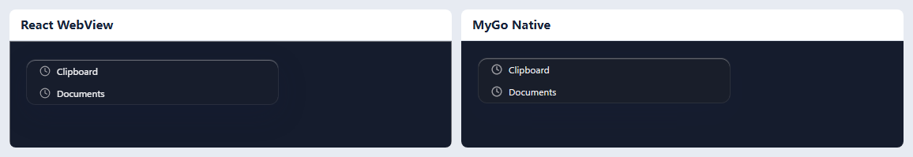 |
| 筛选项 | 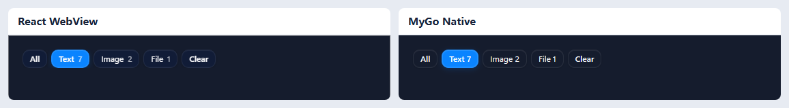 |
| 匹配高亮 | 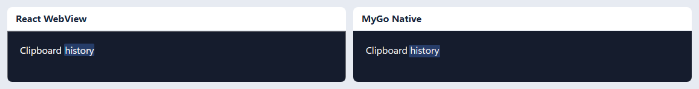 |
| 下拉选择 |  |
| 设置导航 |  |
| 设置页脚 | 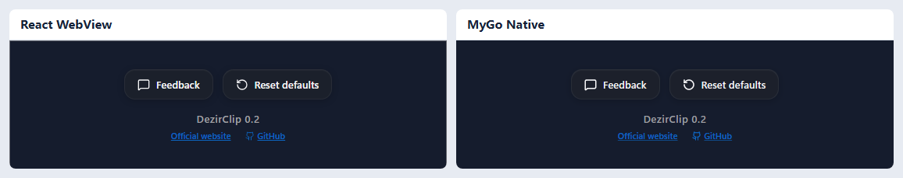 |
| 设置折叠区 |  |
| 设置帮助 |  |
| 确认对话框 | 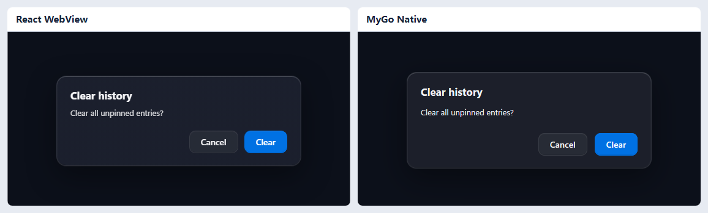 |
| 标签对话框 |  |
| 短提示 |  |
| 进度提示 |  |
| 附件预览 |  |
| 预览工具栏 |  |
| 图片预览 |  |
| 预览窗口缩放手柄 |  |
| 滚轮感应区域 |  |

</details>

<details>
<summary>macOS 浅色</summary>

| 组件 | 两套库的实测画面 |
| --- | --- |
| 应用顶栏 |  |
| 虚拟历史列表 |  |
| 历史卡片 |  |
| 历史卡片信息栏 |  |
| 搜索栏 |  |
| 搜索历史 |  |
| 筛选项 |  |
| 匹配高亮 | 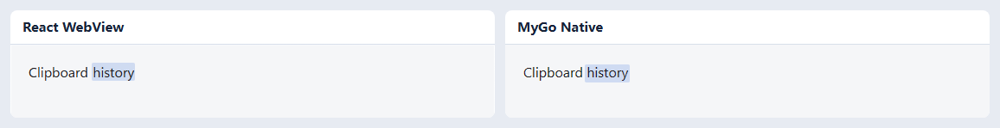 |
| 下拉选择 |  |
| 设置导航 |  |
| 设置页脚 |  |
| 设置折叠区 |  |
| 设置帮助 |  |
| 确认对话框 | 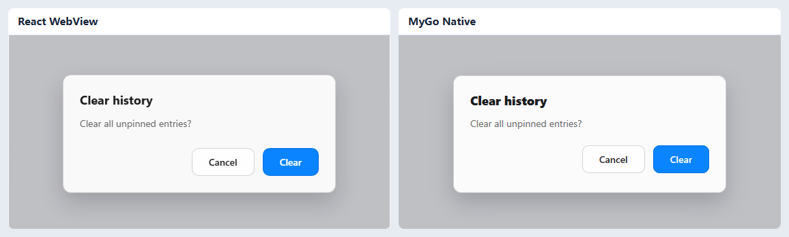 |
| 标签对话框 |  |
| 短提示 |  |
| 进度提示 | 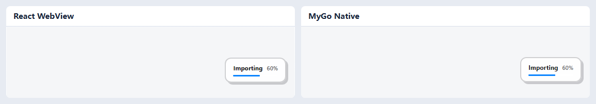 |
| 附件预览 |  |
| 预览工具栏 |  |
| 图片预览 | 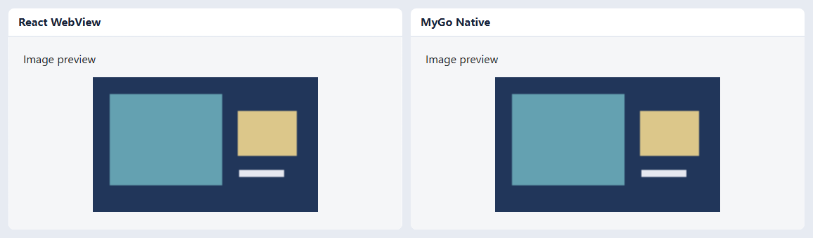 |
| 预览窗口缩放手柄 |  |
| 滚轮感应区域 | 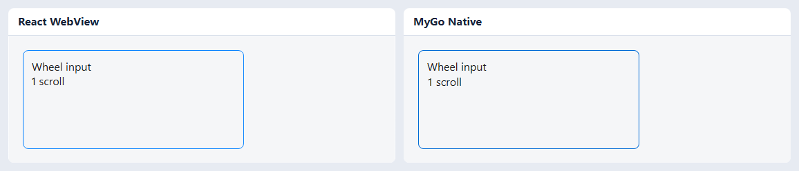 |

</details>

## 构建与验证

```sh
pnpm install --frozen-lockfile
pnpm exec playwright install chromium --only-shell
pnpm run build:react
go -C packages/ui-native test ./...
go -C packages/ui-presets test ./...
go -C packages/ui-presets build -o ../../dzc-ui-gallery ./cmd/dzc-ui-gallery
node scripts/compare-ui-components.mjs native=./dzc-ui-gallery
node scripts/write-ui-comparison-images.mjs 'results=/path/to/result-directory'
node scripts/write-ui-comparison-images.mjs 'results=/path/to/result-directory' theme=macos mode=dark output=docs/comparisons/macos-dark
node scripts/write-ui-comparison-images.mjs 'results=/path/to/result-directory' theme=liquid-glass mode=dark output=docs/comparisons/liquid-glass-dark
```

将 `results` 改为对照脚本输出的目录。Windows 下为原生图集程序使用 `dzc-ui-gallery.exe`。

查看 [许可证范围与第三方声明](LICENSE.md)。
